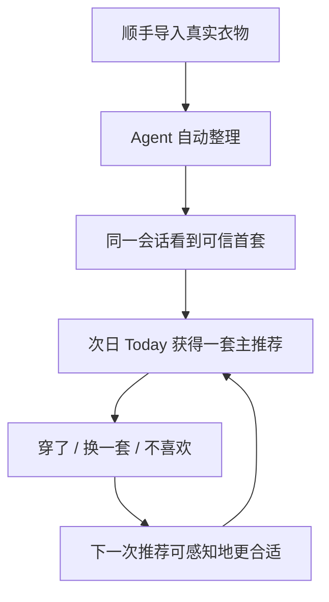
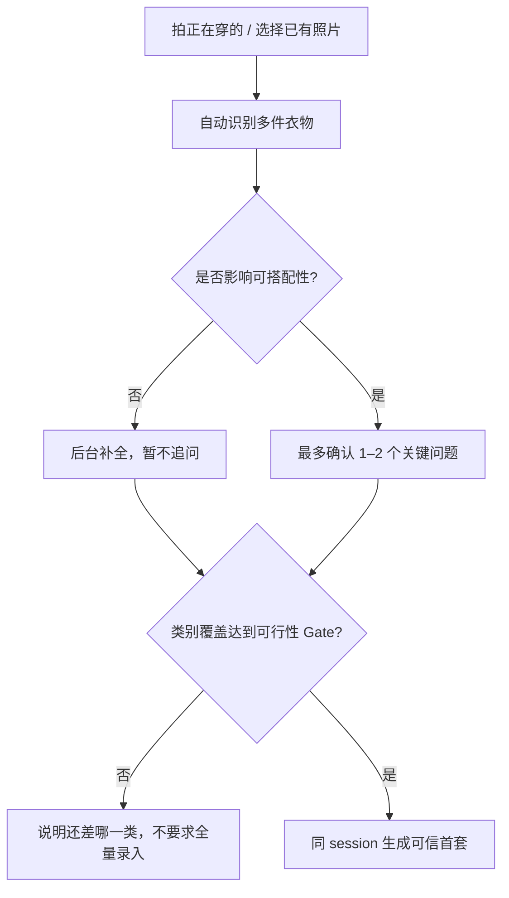

# 衣然 / Aidrobe 产品体验优化与下一阶段执行方案

**Version:** v2.0-p0-hardening
**Date:** 2026-07-15
**Status:** V2 current execution baseline; P0 backend hardening prepared for GitHub CI
**Scope:** V2 体验收敛、主链路验证与下一阶段实施
**Internal repo naming:** 继续使用 `aidrobe-FE` / Aidrobe，不做工程路径与 bundle 重命名

---

## 0. 执行摘要

### 0.0 GitHub 实现基线（2026-07-13）

本版已直接核对以下 GitHub 当前状态：

- [`U2SG/aidrobe-BE`](https://github.com/U2SG/aidrobe-BE) `main` 最新提交：`a4fb4bad`（2026-07-13）；
- [`U2SG/aidrobe-FE`](https://github.com/U2SG/aidrobe-FE) `main` 最新提交：`10be787d`（2026-06-30）；
- FE 当前 V2 实现集中在未合并的 [PR #90](https://github.com/U2SG/aidrobe-FE/pull/90)，head `db6acd07`，共 25 commits / 161 changed files / +27,139 / -3,734，GitHub 显示 mergeable；
- BE 当前没有 open PR；#84、#88、#94、#95、#102–#108 等已进入 `main`。

因此，下一阶段的真实状态不是“大量核心能力尚未开发”，而是：

> **后端 V2 主能力已基本落地并以 feature flag 关闭；前端已在 #90 完成大部分消费，但尚未进入 main。当前首要工作已经从 feature build 切换为 merge hardening、环境启用、契约联调、真机 smoke、性能与隐私收口。**

#### 已落地能力对照

| 能力 | GitHub 证据 | 当前判断 |
|---|---|---|
| First Outfit 可行性 Gate | BE #88；FE #90 已接 `/first-outfit` | 已实现，待真机验证 0/1/≥2 三态与 25 秒级等待体验 |
| 结构化推荐理由 | BE #94 返回 source / item refs / confidence | 已实现，待验证 FE 展示与低置信理由策略 |
| Ask 可反馈标识 | BE #95，以 `ask_session_id` 作为 recommendation id | 已实现，不再属于 API gap |
| 被动学习事件 | BE #102；FE `src/api/events.ts` 已接 | 已实现事件通道，尚未证明能改善推荐 |
| 室内气候推断 | BE #103 | 已实现，flag 默认关；需样本和误推断验证 |
| Context Override | BE #104；FE #90 已发送 `context_override` 并读取 `applied_context` | 已实现，flag 默认关；需 chips / free text / no-skirt 实测 |
| Resurface Insight | BE #105；FE #90 已渲染并发送 viewed/opened | 已实现，flag 默认关；需冷却与采用率验证 |
| 日期感知 Today / Tomorrow | BE #106；FE #90 已发送 `target_date` 并读取 `mode` | 已实现，flag 默认关；真实 tomorrow 模式暂不支持换一套 |
| 记忆查看、纠正、清除与清空数据 | BE #107；FE #90 已接 `/v1/profile/*` | 已实现，flag 默认关；需 403 / empty / destructive flow 实测 |
| 上传鉴权、用户存储前缀、存储删除 | BE #108 | 已实现；需真实 MinIO / OSS 和清空、注销后的对象验证 |
| Android 邀请码登录与 token single-flight refresh | BE #108 + FE #90 head | 已实现测试入口；需并发 401、refresh 失败和缓存清除验证 |

#### 当前 feature flag 启用矩阵

内部测试环境应显式记录并开启：

```text
DEFAULT_TIMEZONE=Asia/Shanghai        # 旧用户兜底；新客户端应写入 IANA timezone
ENABLE_MVP_V2_UI=true                 # FE 构建配置
ENABLE_TODAY_REFRESH=true             # Context Override 的接口前置依赖
ENABLE_TODAY_CONTEXT=true             # 返回生成时的天气、场景与结构化约束
ENABLE_TODAY_REASONING=true           # 返回可追溯的推荐理由
ENABLE_DATE_AWARE_TODAY=true          # BE #106
ENABLE_CONTEXT_OVERRIDES=true         # BE #104
ENABLE_RESURFACE_INSIGHT=true         # BE #105
ENABLE_INDOOR_CLIMATE_INFERENCE=true  # BE #103
ENABLE_DATA_TRUST=true                # BE #107
ENABLE_RECOMMENDATION_DIVERSITY=true  # 避免近期推荐重复
ENABLE_PREFERENCE_MEMORY=true         # 读取显式偏好记忆
ENABLE_FEEDBACK_LEARNING=true         # 反馈影响后续排序
ENABLE_VISION_STYLE_LEARNING=true     # 真实视觉风格学习
ENABLE_SCHEDULER=true                 # 仅启动一个 scheduler 实例
```

被动学习事件端点无 feature flag，可直接接收。测试记录必须包含实际 flag 快照；否则“UI 没生效”无法区分代码问题与环境未启用。

### 0.1 核心结论

衣然下一阶段不应继续按“衣橱管理功能是否齐全”推进，而应围绕一个更清晰的产品定义收敛：

> **衣然是一个基于真实衣橱、每天替用户完成穿搭决策，并从轻量反馈中持续适应的私人穿搭 Agent / Outfit OS。**

面向用户的情感表达仍然是：

> **今天，穿成喜欢的自己。**

面向产品与工程的功能表达是：

> **不用想，今天穿什么已经准备好了。**

下一阶段的首要目标不是增加入口，而是证明以下闭环能够稳定发生：



如果这条链路不能稳定成立，Ask、Insights、Should-I-Buy、衣橱图谱和风格学习越多，产品越容易退化成“功能很多但没有每日使用理由”的衣橱工具箱。

### 0.2 本阶段成功标准

本阶段完成的定义不是“页面已开发”，而是同时满足以下四点：

1. **激活成立：** 新用户能以低负担导入足以搭配的真实衣物，并在同一 session 看到一套可信首套。
2. **决策成立：** Today 默认只给一套主推荐；用户无需理解算法，也能接受、轻改或更换。
3. **信任成立：** 推荐里的衣物、图片、天气、时间、场景、理由和已学习偏好都可追溯，不出现假个性化。
4. **适应成立：** 用户一次自然表达或轻量反馈，能在后续推荐中产生可观察的变化，并允许查看、纠正或清除。

### 0.3 优先级总览

| 优先级 | 目标 | 必须交付 | 暂不扩张 |
|---|---|---|---|
| **P0：把已实现主链路变成可测试版本** | 激活、决策、信任 | 合并/拆解 FE #90；开启 V2 flags；导入→首套→Today 真机 E2E；性能、隐私、日期、鉴权、错误态收口 | 新一级入口、复杂 dashboard、生成式试穿 |
| **P1：证明“更懂我”而非继续接线** | 适应、习惯形成 | 评估 Context Override、局部换单品、被动学习、偏好记忆、室内气候、Resurface 的实际效果；真实单品抠图搭配板 | 问卷式个性化、每日打卡、重运营提醒 |
| **P2：扩大留存与传播** | 0 步触达、衣橱价值、分享 | Widget / 通知验证；Resurface Insights；情境式 Should-I-Buy；分享卡片；旅行等扩展场景 | 自动跨平台订单同步、默认 AI 试穿 |

---

# 1. 产品与体验基线

## 1.1 产品边界

### 要做的

- 用真实衣物帮助用户完成“今天穿什么”的高频决策。
- 理解天气、时间、通勤暴露、室内环境、场景、舒适度、最近穿着和偏好。
- 默认做出决定，必要时允许用户一句话或一次点选干预。
- 从用户已有衣物中重新发现可穿组合，减少忘记、重复购买和买错。
- 把复杂识别、结构化、排序、记忆和推理隐藏在后台。

### 明确不做的

- 不把产品做成需要长期维护的衣橱数据库。
- 不要求复杂风格、身材、职业或生活阶段问卷。
- 不把推荐做成三套或多策略菜单让用户再次选择。
- 不依赖用户每天点击“穿了”才能学习。
- 不使用“显瘦、遮肉、变年轻、更高级”等身体或年龄规训语言。
- V1 不把自动读取淘宝、京东等全平台订单作为前提。
- 不把第三方图像识别 API 作为不可替代的核心依赖。
- 不默认生成假穿搭图或 AI 试穿；生成能力只在 V4 由用户主动触发。

## 1.2 目标用户与种子人群

长期服务范围是 **20–60 岁、衣橱有一定存量、在乎穿着结果但不想持续投入决策精力的女性**。产品按“衣橱行为 + 生活状态”适配，而不是按年龄贴标签。

下一阶段验证应优先招募 **26–45 岁**种子用户，尤其是通勤、工作与家庭任务并行、衣橱不小但常穿范围窄的人。原因不是排除其他年龄，而是这群人的决策压力最稳定，与“每天替我决定一套”的价值匹配度最高。

不应将以下两类用户混入首轮核心指标：

- 衣物绝对数量过少、长期无法形成基本搭配闭环的人；
- 享受完整搭配过程、希望自己控制每个选择的重度时尚玩家。

这两类用户可以使用产品，但失败原因与核心人群不同，会污染对推荐质量和激活率的判断。

## 1.3 不可动摇的体验原则

| 原则 | 产品含义 | 验收问题 |
|---|---|---|
| 悦己优先 | 帮用户穿成自己，而不是把 AI 变成审美权威 | 文案是否让人被理解，而非被纠正？ |
| 用户做判断，Agent 做理解 | 用户上传、点选、自然表达；系统负责结构化与推断 | 是否把字段、权重、标签维护丢给用户？ |
| 默认给决定，随时可干预 | Today 一套主推荐，保留“换一套”和局部调整 | 用户是否又被迫比较多个方案？ |
| 真实可信 | 真实衣物、真实上下文、真实理由、真实记忆 | 任何结论能否解释“为什么知道”？ |
| Safe over clever | 冷启动和低置信状态优先稳妥、可穿 | 首套是否为了惊艳而增加翻车率？ |
| 低打扰学习 | 被动推断优先，轻问有频率上限 | 产品是否把学习成本转嫁给用户？ |
| 可见、可改、可清除 | 记忆与数据不做黑箱 | 用户能否纠正“你理解错了”？ |

## 1.4 信息架构

一级导航保持：

```text
Today / Wardrobe / Ask / Profile
```

各入口只承担一个主要责任：

| 入口 | 核心责任 | 不应承担 |
|---|---|---|
| Today | 给出今天或明天的一套可执行决定 | 多候选浏览、策略选择、复杂解释 |
| Wardrobe | 看见、补充、修正真实衣橱资产 | 要求用户持续做数据库维护 |
| Ask | 处理特殊场景和自然语言调整 | 代替默认推荐主路径 |
| Profile | 数据信任、可控记忆、账户与偏好结果 | 密集参数配置与风格问卷 |

Should-I-Buy 不升为一级入口，继续作为分享商品链接、截图或购物情境中的入口。Insights 作为 Today / Wardrobe 内的留存钩子，不独立做复杂 dashboard。

## 1.5 显示策略

| 阶段 | 显示方式 | 原则 |
|---|---|---|
| V1 | 真实单品卡片 | 先保证真实、清楚、可辨认 |
| V2 | 真实单品抠图搭配板 | 增强“一套”的整体感，不改变真实衣物 |
| V3 | 基于风格画像的版式模板 | 个性化的是表达模板，不伪造衣物 |
| V4 | 用户主动触发的生成式试穿 | 生成必须显式触发、明确标识、可回到真实单品 |

## 1.6 系统能力边界

产品体验应由以下能力协作，而不是由一个 LLM prompt 包办：

| 能力域 | 责任 |
|---|---|
| Context Engine | 天气、时间、目标日期、出门时间、通勤暴露、室内环境、日历场景 |
| Constraint Engine | “不穿裙子”“今天走很多路”“想舒服”等本次覆盖条件 |
| Candidate Engine | 库存状态、类别完整性、天气可行性、搭配兼容性过滤 |
| Ranking Engine | 偏好、近期穿着、新鲜度、场景适配、置信度排序 |
| Learning Engine | 穿了/换一套/不喜欢、太冷/太热、跳过等行为信号 |
| Memory Engine | 明确偏好、弱推断、临时约束、置信度与衰减、用户纠正 |
| Reasoning Engine | 把结构化依据组织成简短、可信、不过度承诺的理由 |

LLM 负责理解和表达，但库存可用性、硬约束、日期、权限、幂等和最终可行性必须由确定性逻辑兜底。

---

# 2. 端到端用户流程与体验优化

## 2.1 主链路状态模型

所有 First Outfit、Today 和 Tomorrow 推荐统一建模为短生命周期的 **Recommendation / Decision Session**，而不是一次性接口结果。

Session 至少应保存：

```text
session_id
user_id
target_date
mode
source_context
applied_context
active_constraints
outfit_version
item_ids + item_roles
reason_sources
confidence
generation_status
user_actions
created_at / expires_at
```

Session 必须支持：

- 整套换一套；
- 只换上衣 / 下装 / 鞋 / 外层等局部重生成；
- 增加、移除或替换本次 constraint；
- 记录推荐版本与反馈对应关系；
- 在日期、天气或衣物状态变化后判断缓存是否失效；
- 将“今天不穿裙子”限定在本次或指定期限，不污染长期偏好。

## 2.2 Flow A：首次进入与衣物导入

### 用户目标

不是“建立完整衣橱数据库”，而是尽快让衣然拥有足够真实衣物，给出第一套能穿的搭配。

### 支持方式

V1 必须保留四条导入路径：

1. 直接拍照；
2. 从相册或截图导入；
3. 粘贴商品链接；
4. iOS Share Extension 分享商品或内容进入衣然。

不要把自动跨平台订单同步放进首轮激活前置条件。

### 推荐流程



### 优化规则

- 第一个动作优先写成“拍一下你现在穿的这件”或“从最近照片里选一件”，弱化“开始建档”的任务感。
- 多件同图继续走 candidate items → 用户必要确认 → confirm-items 闭环。
- 只确认会改变搭配可行性的字段，例如类别误判、是否可穿、关键颜色冲突；品牌、材质等低风险字段可后补。
- 通用确认预算最多 2 个问题；22:00 后最多 1 个问题。
- 用类别覆盖判断“可出首套”，不使用简单件数：如上衣 + 下装 + 鞋，或连衣裙 + 鞋；外层和配饰按天气与场景决定是否为硬 Gate。
- 不足时明确告诉用户“还差哪一类就能出第一套”，避免模糊进度条和“请继续完善衣橱”。
- 生成过程中先给稳定进度和已识别结果，避免空白等待。

### 验收标准

- 四种导入方式均能进入同一标准化 pipeline。
- 单图多件不会静默丢失，也不会生成重复衣物。
- 用户可修正关键识别结果，修正后推荐使用最新数据。
- 可行性 Gate 通过后，在同一 session 自动出现首套，无需用户再进入 Today 寻找。
- 任何首套均引用真实、当前可用的 `item_id`，图片加载失败有明确替代态。

## 2.3 Flow B：First Outfit 激活时刻

### 目标

让用户第一次明确感受到：“我刚加入的真实衣服，已经被组合成能穿的一套。”

### 体验规则

- 首套采用 safe over clever：优先颜色、场景、天气和衣物状态都稳妥的组合。
- 默认只展示一套，不提供三套横滑列表。
- 显示 1–2 条足够具体的理由，理由只能来自真实 `reason_sources`。
- 若上下文不足，明确说“先按当前天气与已加入衣物给一套稳妥组合”，不伪装了解用户风格。
- 主操作为“就穿这套”；次操作为“换一套”；局部换单品在用户表达需要时出现。
- 首套完成即写入 Recommendation Session，后续动作不能丢失来源版本。

### 首套可信 Gate

以下任一失败则不能对外宣称已生成可信首套：

- 存在不可用、已删除或状态冲突的衣物；
- 缺少场景所需的基本类别；
- 图片/卡片无法辨认对应衣物；
- 推荐理由与真实天气、日期、用户输入不一致；
- 硬约束未满足；
- 组合虽在数据上完整，但渲染后无法清楚呈现。

## 2.4 Flow C：Today 的时间感知体验

### 模式

沿用并固化现有状态机：

| Mode | 建议触发 | 主语义 |
|---|---:|---|
| `morning_today` | 距常用出门时间 ≤ 180 分钟，或早间主动访问 | 为今天出门做决定 |
| `daytime_today` | 当日白天、尚有今日价值 | 今天仍可执行的推荐 |
| `evening_tomorrow` | 本地时间 ≥ 18:00 | 提前准备明天 |
| `late_night_tomorrow` | 本地时间 ≥ 22:00 | 最少打扰、快速决定明天 |
| `empty_or_cold_start` | 数据不足或无法可信推荐 | 诚实说明下一步 |

具体时段必须以用户本地时区计算，服务端 `target_date` 与客户端展示日期保持一致。

### Today 首屏层级

1. 当前目标：今天 / 明天、场景、必要的天气信息；
2. 一套主推荐的真实衣物画面；
3. 一句核心判断 + 1–2 条理由；
4. “就穿这套”；
5. “换一套”与快速 constraint chips；
6. 低优先级 insight，不得抢主推荐注意力。

### Context Override

点选是主路径，打字是补充。默认展示少量高频 chips，例如：

```text
想舒服一点 / 今天有会 / 要走很多路 / 不穿裙子 / 想低调 / 想被看见
```

规则：

- 点击后立即形成结构化 constraint，并展示已应用状态；
- 支持撤销；
- 明确区分 `session_only`、`until_date` 和 durable preference；
- 自然语言由系统解析为同一 constraint schema；
- `applied_context` 必须回显服务端实际采用的值，不能只在前端做视觉假反馈。

### “换一套”的心理表达

单套推荐不等于封死选择。文案和动效应表达“这套是衣然替你先做的决定，你随时可以看另一个可能”，避免“AI 不满意才给退路”的压迫感。

## 2.5 Flow D：局部调整与 Ask

### 局部调整优先

用户说“鞋不行”“不想穿这条裙子”“外套换轻一点”时，只替换受影响的角色，并尽量保持其余已接受部分不变。整套重生成是兜底，不是默认。

### Ask 的责任

Ask 用于特殊、开放或多轮场景：

- 今天临时有会议；
- 晚上还要聚会；
- 想把某件很久没穿的衣服搭起来；
- 旅行或特殊活动；
- 用户想解释为什么不喜欢。

Ask 不应承担每日默认推荐。对话产生的可执行结果应回写 Recommendation Session，而不是停留在聊天文本里。

### 多轮一致性

- 后一轮保留已接受的条件；
- 用户否定某个局部时，不重置全部上下文；
- 每轮显示当前仍在生效的 constraints；
- 只有用户明确表达长期偏好时才写入 durable memory；
- 对推断性记忆标注“衣然的理解”，允许纠正。

## 2.6 Flow E：反馈与适应

### 显性动作

```text
穿了 / 换一套 / 不喜欢
```

“不喜欢”后可按需出现轻量原因：

```text
太冷 / 太热 / 不像我 / 不方便 / 不适合今天 / 不想穿这件
```

原因选择不是完成动作的必填项。

### 被动信号

- 打开后停留、保存或分享；
- 反复换掉的单品角色；
- recommendation 后手动标记穿着；
- Ask 中的自然表达；
- 同类天气下“太热 / 太冷”的重复错配；
- 对 resurfaced item 的接受或忽略。

### 频率上限（作为 MVP 默认值实施，后续以数据调整）

- `PassiveWearPrompt` 每周最多 2 次；
- 连续忽略 2 次后冷却 14 天；
- 同一件衣物的 `ResurfaceInsight` 间隔不少于 14 天；
- 单次 Today 最多出现 1 条非核心 insight；
- 22:00 后不弹出非必要反馈追问。

### 学习可信度

| 信号 | 默认处理 |
|---|---|
| 用户明确说“办公室很冷” | 直接形成可见、可改的偏好记忆 |
| 同类条件下重复“太冷/太热” | 累积为中等置信推断 |
| 单次换一套 | 只影响当前 session 与短期排序 |
| 单次未点击“穿了” | 不得推断为没穿或不喜欢 |
| 衣橱构成、准备时长等间接信号 | 仅用于打破平局，不独立切换策略 |

## 2.7 Flow F：室内 / 通勤气候

推荐需将天气拆成两个问题：

1. **通勤片段暴露：** 室外极端温度、降雨、步行距离，决定是否需要方便穿脱的外层或更稳的鞋；
2. **主要停留环境：** 办公室空调、暖气和室内活动，决定主体穿着的舒适度。

默认不新增问卷。信号优先级：

1. 用户在 Ask / Override 中的明确表达；
2. “太冷 / 太热”与室外气温的重复错配；
3. 已有 DepartureTime 触点中的一次可跳过微问题：`多接触室外 / 少接触室外 / 跳过`；
4. 其他弱信号仅作平局判断。

输出时不要给用户贴“室内通勤用户”等标签。理由应具体描述当天策略，例如：

> 今天室外热，但你大部分时间在空调环境里，这套保留了一件方便穿脱的薄外层。

## 2.8 Flow G：Wardrobe、Insights 与 Should-I-Buy

### Wardrobe

把衣橱表达为“我的审美资产”，而不是库存后台。优先支持：

- 快速找到真实衣物；
- 纠正 AI 识别和状态；
- 查看穿着与搭配关系；
- 从 Today / Insight 直接定位某件衣物；
- 手动 wear 操作幂等，避免重复累加。

### Insights

Insights 的首要价值是让用户重新发现已有衣物，而不是评分和批评衣橱。应采用：

```text
“这件最近没出现，但和你常穿的两件都能搭。”
```

避免：

```text
“你的衣橱利用率低 / 不健康 / 浪费严重。”
```

### Should-I-Buy

继续作为情境入口：用户分享商品链接或截图时触发。回答优先基于：

- 是否与现有衣物形成多个可执行组合；
- 是否与已有单品高度重复；
- 是否填补真实缺口；
- 是否符合已知场景与维护成本。

不制造购买冲动，也不替用户下最终价值判断。

## 2.9 Flow H：Profile、数据与信任

Profile 必须有清晰的“你的数据”区域，并使用“你的衣橱，只属于你”这一信任表达。至少包括：

- 衣然使用了哪些数据，以及为什么需要；
- 已学习的偏好与推断，可查看、修改、删除；
- 清除推荐历史、偏好记忆或衣橱数据的分层操作；
- 数据导出状态与下载生命周期；
- 账户删除；
- 权限关闭后的真实影响。

产品信任文案不能超出后端真实能力。禁止展示假 learned memory、假导出进度或仅前端删除。

## 2.10 跨流程异常与降级

| 场景 | 正确体验 | 禁止行为 |
|---|---|---|
| 天气不可用 | 使用城市/最近有效值或明确按衣橱给稳妥推荐，并标识依据 | 编造实时天气 |
| 图片失败 | 保留衣物名称、类别、颜色和重试入口 | 空白卡片或错图 |
| 衣物不足 | 精确说明缺少的类别，并允许继续浏览/导入 | 无限 loading 或假推荐 |
| 推荐超时 | 保留上次有效结果，说明正在更新，允许稍后重试 | 清空 Today |
| Profile memory 403 | 区分无权限、未登录和“暂无记忆” | 把 403 渲染成空状态 |
| 日期切换 | 使旧 target_date 缓存失效，保留必要历史 | 把昨天推荐显示成今天 |
| Context 未应用 | 明确失败并恢复旧 session | 前端显示已应用、后端实际未采用 |
| 导出失败/过期 | 显示真实状态、重试和生命周期 | 永久“处理中” |

---

# 3. 优先级、验证计划与实施建议

## 3.1 优先级判定方法

所有需求用四个问题排序：

1. 是否直接提高“导入 → 可信首套 → 次日 Today”的完成率？
2. 是否降低错误日期、假理由、假个性化等信任风险？
3. 是否让用户一次反馈后感到下次更合适？
4. 是否增加主路径外的新入口、维护成本或选择负担？

前三项越强越靠前；第四项越强越后置。

## 3.2 P0：合并、启用与发布硬化（建议 0–2 周）

### P0-0 控制 FE #90 的合并风险

PR #90 已不是一个普通 UI PR，而是包含 IA、Today、Onboarding、Profile、认证、API contract、设计资产和文档的发布分支。其 161 个 changed files 与 27k+ additions 意味着“mergeable”不等于“可安全合并”。

执行要求：

- 以功能域建立合并验收表：Auth / Onboarding / Import / First Outfit / Today / Ask / Profile / Data Trust；
- 用 PR head 重新生成并对比 OpenAPI 类型，检查 BE #108 后的 auth / presign contract；
- 运行 `tsc + lint + regression scripts`，并保留 V1 flag-off 回归；
- 如仍需继续新增能力，优先停止向 #90 追加，后续改为小 PR；
- #90 合并后立即删除仅属于旧实现的注释、gap 表和“BE 尚未实现”说明，避免文档反向误导测试。

### P0-1 Golden Path 真机 E2E Gate

仓库已有 `docs/qa/aidrobe-v2-internal-smoke-test-v0.1.md`，不再另造一份清单；应先更新其中已经过期的 gap 描述，再以真机执行：

```text
邀请码 / Apple 登录
→ presign 上传
→ 单件与多件导入
→ First Outfit 0 / 1 / ≥2 三态
→ Today / Tomorrow
→ Context Override
→ 反馈 / passive event
→ Resurface
→ Profile memory / clear data / logout
```

至少覆盖：全新安装、覆盖安装、弱网、接口超时、跨日、18:00 / 22:00、图片失败、flag-off 和 token 过期。

### P0-2 先解决 25–27 秒推荐等待

最新 FE 代码明确记录：Today 冷缓存约 27 秒，refresh / first-outfit 约 25 秒，因此客户端将 timeout 放宽到 60 秒。这避免了“后端成功、前端报网络异常”，但没有解决用户体验问题。

发布前必须：

- 分离接口各阶段耗时：DB / weather / candidate / ranking / LLM reason / image；
- Today 主推荐优先返回确定性结果，LLM 润色和非核心解释允许后补；
- 在出门时间前预计算或异步刷新次日/当日推荐；
- First Outfit 使用阶段性进度，且深夜不让用户盯住空白页；
- 记录 P50 / P95，而不是把 60 秒客户端 timeout 当性能验收。

初始体验门槛：缓存命中 P95 ≤ 1.5 秒；可行性 Gate P95 ≤ 2 秒；需要生成时 3 秒内出现可理解进度，主结果 P95 目标 ≤ 8 秒。未达到时允许内部测试，不进入扩大邀请。

### P0-3 日期、Tomorrow 与缓存实测

BE #106 与 FE #90 已完成 `target_date` / `mode` 接线，工作改为启用与验证：

- 开启 `ENABLE_DATE_AWARE_TODAY`；
- 覆盖本地时区、跨午夜、时区变化、天气更新、衣物状态变化和 clear-data 后的缓存失效；
- 校验 FE 计算的 tomorrow 日期与 BE `recommendation_date` 一致；
- **当前真实 tomorrow payload 会禁用“换一套”**，因为 refresh 仍只生成 today：内部测试可接受，但必须作为已知产品缺口记录，不能在测试中误报为按钮故障；
- 下一阶段再决定补 `target_date` refresh，或将明日模式明确定位为不可更换的预览。

### P0-4 Context Override 可信闭环

BE #104 与 FE #90 已接通，重点不再是写接口，而是验证：

- 七个 chips 均映射到封闭 taxonomy；
- `noSkirt` 同时排除 dress 与 skirt bottom；
- free text 不能绕过 taxonomy 或注入任意行为；
- FE 只展示服务端实际回传的 `applied_context`；
- 连续 override、失败恢复、429 与 flag-off 均不产生视觉假成功。

### P0-5 数据、存储与鉴权闭环

- BE #84 的 standalone wear 已按 `(item, worn_date)` 幂等实现，工作改为并发/重试 smoke，而非再次设计幂等方案；
- BE #107 已实现 memory review/correct/clear 与 clear-all，验证 403、空列表、删除、清空后 Today 缓存和旧画面都被清理；
- BE #108 已实现 presign 鉴权、`users/{user_id}/` key prefix 与 storage purge，必须验证 MinIO / OSS 真实对象确实被删除；
- 验证邀请码同码不同设备不会共享衣橱；并发 401 只触发一次 refresh，失败后 token、onboarding state 与 query cache 一起清空；
- DSAR / export 验证 queued / processing / ready / expired / failed 生命周期和下载 URL 过期行为。

### P0-6 隐私与文案代码收口

最新前端仍有两项需要在 #90 合并前处理：

1. `TodayV2Screen` 将 Context Override 的原始 `payload`（包括用户自由文本）发送到 analytics；应改为 chip id、文本长度/类别或服务端返回的结构化 constraint，不能把自然语言全文写入通用分析事件。
2. `SCENE_LABEL` 仍在组件中硬编码 `通勤 / 正式 / 休闲`；应复用统一 scene i18n，避免 en-US 泄漏中文。

同时确认：

- BE #94 的结构化理由使用稳定 source enum；
- BE #91 的 body/age copy guard 覆盖所有 LLM 文案出口；
- DataTrustScreen 中“不用于训练 / 不共享 / 不做广告画像”等承诺与真实数据处理、第三方服务和正式隐私政策一致；
- 用户可见文案继续进入 i18n，不把 mock、gap 注释或内部功能名渲染给用户。

### P0-7 Recommendation Session 的现实收敛

当前实现已经有 persisted outfit、daily recommendation、`ask_session_id`、`outfit_version` 所需的部分基础，但尚未形成统一的跨 FirstOutfit / Today / Tomorrow Recommendation Session 实体。

为避免阻塞实测：

- 本轮先以 `outfit_id / ask_session_id + target_date + applied_context + event attribution` 完成可追溯验收；
- 完整 session version、constraint lineage、局部重生成历史放入 P1 架构项；
- 若实测发现反馈无法准确归因或局部修改破坏上下文，再将统一 Session 提升回 P0。

### P0 完成标准

- FE #90 合并后 `main` 可构建，V1 / V2 两种 flag 均通过回归；
- 所需 BE migrations 与 flags 在内部环境真实启用并有版本记录；
- Golden Path 真机 smoke 全绿，失败项带复现步骤；
- 日期、上下文、结构化理由、反馈事件和数据删除可端到端追溯；
- 原始自然语言不进入通用 analytics；
- 生成等待达到内部测试门槛，或至少有清楚的阶段反馈与性能修复 issue；
- 任一硬约束失败时不生成“看起来成功”的结果。

## 3.3 P1：适应性与习惯形成（建议 2–6 周）

### P1-1 局部重生成

FE 已有 outfit item replacement 入口与候选接口基础；下一步不是只验证“能换”，而是验证替换后是否保留其余已接受单品、理由和 constraints，并评估其对整套换一套率和接受率的影响。

### P1-2 记忆与被动学习效果

- BE #102 已有 append-only event stream，弱信号不会覆盖明确偏好；
- BE #107 / FE #90 已让记忆可见、可纠正、可删；
- 下一步补齐 confidence 变化、evidence count、last observed / expiry 的可验证规则；
- 用固定 case 证明同类反馈会改变后续排序，而不是只证明 event 写入数据库。

### P1-3 室内 / 通勤气候

BE #84 / #103 与 FE #90 已接入 `commute_exposure`、`indoor_climate_inference` 和 temperature mismatch telemetry；下一步开启 flag，以受控 case 验证阈值、可移除外层策略和误推断率。主动微问题仍只允许出现在 DepartureTime 触点，且必须可跳过。

### P1-4 推荐评测闭环

建立离线 case set 与线上信号共同评估：

- 硬约束满足率；
- 衣物可用性；
- 天气/场景适配；
- 重复度与新鲜度；
- 对已知负反馈的回避；
- 理由与实际依据一致性。

### P1-5 V2 真实单品搭配板

使用真实单品抠图生成 outfit board；必须通过渲染可行性 Gate，失败时回退到 V1 单品卡片，不阻塞推荐。

### P1-6 克制的被动触达

FE #90 已有 prompt frequency 与 resurface cooldown 相关实现；下一步验证频率上限、忽略降频、深夜静默和同 item 14 天冷却确实跨重启生效。暂不直接扩大 push 量。

## 3.4 P2：留存、传播与扩展（建议 6–12 周后按证据进入）

- Widget / 通知作为“0 步终局”的小流量原型；先验证打开率与关闭率，再扩大。
- Resurface Insight 将被忘记的衣物带回 Today，而不是单独做复杂 dashboard。
- 分享卡片基于真实搭配板，允许隐藏敏感场景、位置和个人信息。
- Should-I-Buy 强化重复款和真实缺口判断，但维持情境入口。
- 旅行打包、日历深度联动等仅在主闭环稳定后进入。

## 3.5 待验证假设

以下内容必须被当作假设，而不是已经成立的事实：

| ID | 假设 | 最小验证 | 核心指标 | 通过标准（初始） | 失败后的动作 |
|---|---|---|---|---|---|
| H1 | 同 session 看到首套能显著提高激活与次日回访 | 新用户灰度：首套立即出现 vs 仅导入成功 | 首套到达率、D1 回访 | 首套组 D1 相对提升 ≥15%，且投诉不升 | 优先查等待、可信度和衣物 Gate，不先加奖励机制 |
| H2 | Today 一套主推荐比三套菜单更省决策 | 可用性测试 + 行为对照 | 决策时长、接受率、主观负担 | 决策时长下降，接受率不低于对照 | 优化“换一套”可见性，而非直接恢复三套 |
| H3 | 局部换单品比整套换一套更符合真实不满 | 给部分用户开放角色级替换 | 局部替换完成率、最终接受率 | ≥30% 的换装意图使用局部替换，最终接受率提升 | 检查入口和角色识别；使用率仍低则后置 |
| H4 | 26–45 岁高压通勤用户是最强种子人群 | 20–25 / 26–45 / 46–60 分层访谈与试用 | 激活、D7、每周有效 Today | 26–45 至少两项领先且质性价值明确 | 改为按行为强度而非年龄招募 |
| H5 | 室内气候是天气推荐翻车的重要来源 | 采集温度错配与通勤暴露 | 太冷/太热率、纠正后改善 | 有足够样本显示错配集中，策略后下降 ≥20% | 不扩大模型，仅保留显式 override |
| H6 | 被动学习足以减少每日打卡依赖 | 对比仅轻问与频繁确认 | 反馈覆盖率、打扰关闭率、推荐提升 | 打扰量下降且推荐质量不下降 | 增加情境式轻问，不做每日签到 |
| H7 | 被忘记衣物的 resurfacing 能形成留存价值 | 每周最多 1 条真实 insight | 点击、加入搭配、穿着确认 | insight 后 14 天内被采用率有实质提升 | 改善解释或降低频率，不做焦虑化评分 |
| H8 | 真实抠图搭配板增强信任和“成套感” | V1 卡片 vs V2 board | 理解速度、接受率、图片失败率 | 接受率/理解至少一项提升，失败率在门槛内 | 保留 V1 回退，不让视觉阻塞核心推荐 |
| H9 | Context chips 比输入框更容易表达临时需求 | chips-first 与 input-first 测试 | override 使用率、成功应用率 | chips-first 使用率明显更高且误触可控 | 调整 chips 内容与数量 |
| H10 | Widget / 通知能成为低打扰的 0 步入口 | 小流量、可退出试验 | 查看/打开、关闭通知、卸载 | 有持续查看且关闭/卸载无显著上升 | 保持 P2，不做强提醒 |

> 通过标准是首轮执行门槛，不是永久 KPI。达到样本量前不做胜负结论；同时看定量与用户原话，避免把“没点击”误判成“不需要”。

## 3.6 指标体系

### 北极星候选

**Weekly Accepted Outfit Decisions（每周被接受的有效穿搭决定数）**

一次有效决定应满足：推荐成功展示，用户明确接受，或后续有高置信穿着信号；仅打开 Today 不计入。

### 漏斗指标

| 阶段 | 指标 |
|---|---|
| 导入 | 首次导入开始率、完成率、每种来源成功率、多件确认放弃率 |
| 激活 | 可行性 Gate 达成率、首套生成率、Time to First Outfit、首套接受/换装/退出 |
| 决策 | Today 有效展示率、决策时长、接受率、整套/局部换装率、constraint 应用成功率 |
| 适应 | 同类负反馈重复率、记忆纠正率、下一次推荐改善率 |
| 留存 | D1 / D7、每周有效 Today 天数、Weekly Accepted Outfit Decisions |
| 信任 | 假理由/错日期/错衣物率、图片失败率、权限误渲染率、数据删除/导出失败率 |

### 守护指标

- 深夜额外提问数；
- 被动提示关闭/忽略率；
- 通知关闭与卸载；
- 生成或推荐 P95 延迟；
- 无法回退的错误率；
- 用户纠正后再次犯同类错误的比例。

## 3.7 建议埋点

统一事件命名，至少覆盖：

```text
import_started
import_source_selected
import_items_detected
import_confirmation_shown
import_confirmation_completed
wardrobe_feasibility_reached
first_outfit_requested
first_outfit_rendered
first_outfit_failed
recommendation_session_created
today_viewed
recommendation_accepted
recommendation_regenerated
outfit_item_swapped
context_override_selected
context_override_applied
context_override_rejected
feedback_submitted
passive_prompt_shown
passive_prompt_ignored
temperature_mismatch_reported
memory_created
memory_corrected
memory_deleted
insight_shown
insight_acted
data_export_requested
data_export_ready
data_export_failed
```

每个推荐相关事件必须携带：

```text
session_id / outfit_version / target_date / mode /
context_version / reason_sources / item_roles /
latency_ms / experiment_ids
```

隐私原则：不把用户自然语言全文、精确位置和衣物图片内容直接写入通用分析事件；需要研究时使用受控、最小化的数据路径。

## 3.8 六周实施建议

### Week 1：收口并合并 FE #90

- 冻结 #90，不再继续追加新功能；按功能域完成 merge checklist。
- 同步 BE 最新 OpenAPI，修复 raw override analytics、scene label i18n 与过期 gap 文档。
- 验证 Android invite login、single-flight refresh、presign auth 和 V1 flag-off。
- 合并后以 `main` 构建 preview-v2 包。

### Week 2：开启后端能力并完成真机 E2E

- 应用所需 migration，显式开启 #103–#107 对应 flags。
- 更新并执行仓库现有 smoke 清单，不再把已落地能力标为“BE 未实现”。
- 完成导入→首套→Today/Tomorrow→override→反馈→Profile/clear-data 全链路。
- 将所有 FAIL 变成可复现 issue；区分 feature flag、环境、契约与产品 bug。

### Week 3：性能与可靠性

- 对 25–27 秒推荐链路做阶段耗时 profiling。
- 拆分确定性推荐与 LLM 润色，验证预计算/异步方案。
- 覆盖跨日缓存、refresh 429、并发 401、弱网重试、对象删除和导出 URL 过期。
- 达到内部测试性能门槛后才扩大邀请。

### Week 4：适应性有效性

- 用固定 case 验证 explicit / feedback / inferred 的优先级。
- 验证 temperature mismatch → indoor climate → 下一次 ranking/reason 的完整因果链。
- 验证 resurface cooldown、prompt frequency 与重启后的持久性。
- 建立首批 recommendation eval cases。

### Week 5：局部调整与视觉质量

- 验证角色级单品替换是否保留其余单品和 constraints。
- 灰度真实单品抠图搭配板，保留 V1 卡片回退。
- 决定是否补 tomorrow refresh；未补前保持明确的预览语义。
- 开始 H3 / H5 / H8 小流量验证。

### Week 6：种子用户验证与取舍

- 完成 8–12 名核心种子用户的任务观察与访谈，优先 26–45 高压通勤人群，同时保留其他年龄对照。
- 汇总漏斗、错误、用户原话与 session replay 的隐私安全摘要。
- 只把有证据的 P2 项目放入下一周期；没有证据的功能保持后置。

## 3.9 团队工作流与 Definition of Done

### 每个需求必须包含

- 用户问题与对应主流程；
- 不做什么；
- FE/BE contract 与状态变化；
- telemetry；
- empty / loading / error / permission / retry；
- 本地时区与 target date；
- 无障碍与 i18n；
- 真实数据和回退策略；
- 验收用例。

### 一个体验项只有在以下条件同时满足时才算完成

1. FE 与 BE 使用同一 contract；
2. AI 输出经过确定性 Gate；
3. 正常、空、错、慢、无权限、跨日均有体验；
4. 埋点能验证假设；
5. 文案来自可治理资源；
6. 真机 smoke 通过；
7. 不增加未经验证的一级入口；
8. 用户能撤销、纠正或退出关键智能行为。

## 3.10 建议拆分的执行 Epic

| Epic | 目标 | 关键 Deliverables | Priority |
|---|---|---|---|
| E0 V2 Merge & Rollout | 将 #90 与 BE main 变成可运行版本 | merge checklist、flag matrix、migration、preview build | P0 |
| E0.5 Recommendation Performance | 将 25–27 秒等待降到可用范围 | profiling、deterministic-first、预计算、P95 | P0 |
| E1 Golden Path Reliability | 主链路不掉线 | fixture、E2E、错误态、真机 smoke | P0 |
| E2 Recommendation Session | 推荐可持续修改与归因 | session schema、版本、constraint lineage | P1（按实测升级） |
| E3 Context Trust | 上下文实际生效且可解释 | override、applied context、reason sources | P0 验证 |
| E4 Data Trust | 权限、wear、导出与对象删除真实可靠 | 403 语义、幂等、DSAR、storage purge | P0 验证 |
| E5 Adaptive Learning | 反馈后能变得更合适 | memory 分层、被动信号、可纠正 | P1 |
| E6 Climate Intelligence | 理解室内与通勤现实 | commute exposure、mismatch、reasoning | P1 |
| E7 Real Outfit Canvas | 提升成套感和信任 | cutout board、渲染 Gate、V1 fallback | P1 |
| E8 Retention Hooks | 克制地形成日常习惯 | resurface、widget/通知小流量验证 | P2 |

## 3.11 下一阶段决策门

六周后只回答四个问题：

1. 新用户是否能在第一次使用中看到并理解一套真实首套？
2. 用户是否愿意让 Today 替她先做决定，而不是把它当灵感列表？
3. 一次轻量反馈是否真的改变了下一次结果？
4. 真实、上下文和数据控制是否足以建立长期信任？

如果其中任一答案是否定的，继续修主链路，不扩张 P2。只有当四个问题都有证据支持，衣然才应进入更强的 0 步触达、分享、洞察和扩展场景。

---

## 附录 A：本方案继承的已定决策

- 品牌名：**衣然 YIRAN**；推荐 App Store 标题：**衣然 - AI穿搭衣橱**。
- 主标语：**今天，穿成喜欢的自己。**
- Today 短句可使用：**今天这套，恰好。**
- 一级导航：Today / Wardrobe / Ask / Profile。
- Today 默认一套主推荐，不设置 strategy rail 或多候选菜单。
- 导入必须支持拍照、链接、截图、iOS Share Extension。
- 不把跨平台订单自动同步或第三方图像识别服务设为 V1 核心前提。
- 用户可见产品名可以迁移为“衣然”，内部工程命名继续保留 Aidrobe，避免无价值重命名。
- V1 真实单品卡片；V2 真实抠图搭配板；V3 风格模板；V4 用户主动生成试穿。
- “穿了”是可用信号，不是产品依赖；被动学习与偶尔轻问优先。
- Profile 必须提供人话的数据说明、记忆控制、导出与删除能力。

## 附录 B：当前实现状态与最近风险

截至 2026-07-13，可作为下一阶段起点的已知状态：

- 多件导入闭环已交付：BE candidate items / confirm-items 与 FE multi-confirm 已形成基础链路。
- BE `main` 已包含：V2 gap fill (#84)、First Outfit Gate (#88)、copy safety (#91)、structured reasons (#94)、Ask feedback id (#95)、passive events (#102)、indoor climate (#103)、Context Override (#104)、Resurface (#105)、date-aware Today (#106)、data trust (#107)、presign/storage/auth hardening (#108)。
- BE #84 的 manual wear 已实现原子递增和 `(item, worn_date)` 幂等；此前文档中的“尚未实现幂等”判断已失效，剩余工作是并发与重试验证。
- FE V2 能力仍集中在 open PR #90，而非 `main`。该 PR 已实际消费 `target_date`、`mode`、`context_override`、`applied_context`、`resurface_insight`、passive events 与 profile memory/data endpoints。
- FE #90 head 同时加入 Android 邀请码登录与 single-flight refresh；这是内部测试可达性的关键，不是产品价值验证本身。
- 仓库 smoke 文档的“已知缺口”段落落后于最新代码：BE 能力已合入，且 FE 也已部分/大部分接线。合并前必须更新，否则测试人员会把真实 bug 当成“预期缺口”。
- FE 当前代码显示 cold-cache Today 约 27 秒、First Outfit / refresh 约 25 秒。60 秒 timeout 只修复误报，不代表体验达标。
- 真实 tomorrow 推荐目前不能 refresh，FE 会禁用换一套；需要作为明确产品限制验证。
- `TodayV2Screen` 仍将原始 Context Override 文本写入 analytics，并硬编码中文 scene labels；这两项应在 #90 合并前修复。
- Data Trust UI 已展示强隐私承诺；上线前必须确认与服务端、对象存储、第三方模型/天气服务和正式隐私政策一致。

本方案将“CI 通过”视为可进入体验验收，不视为功能已经被用户验证。

## 附录 C：本次 GitHub 核对范围

本版直接读取或检查了：

- FE / BE 最新 commit 列表与 open PR 状态；
- FE PR #90 metadata、head commit 与 161 个 changed filenames；
- FE #90 的 `src/api/recommendations.ts`、`TodayV2Screen.tsx`、`src/api/events.ts`、`src/api/profile.ts`、`DataTrustScreen.tsx`；
- FE #90 内的 V2 smoke test、gap analysis、implementation plan 与产品基线文档；
- BE #84、#88、#91、#94、#95、#102–#108 的合并提交信息；
- BE 最新 #108 的 auth、presign、storage purge 与 readiness 相关 diff。

本次不是对 FE #90 全部 27k 行变更的逐行 deep review；文档中的 GitHub 结论用于校准产品实施状态与发布优先级。正式合并仍需按功能域完成代码审查和真机验证。
